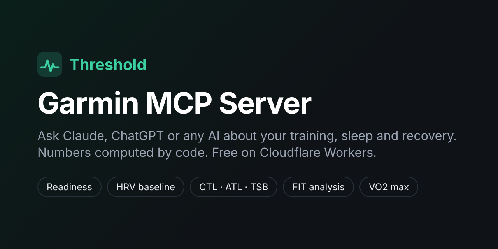

<div align="center">

# Threshold: Garmin MCP Server

**Your Garmin data, analyzed by Claude, ChatGPT and any AI assistant.**
An open-source Garmin MCP server on the official Garmin Personal API. It answers questions about your training, sleep, HRV and recovery, with numbers computed by code, not guessed by the model.

[](https://github.com/KareemmSayed/threshold/actions/workflows/ci.yml)
[](LICENSE)
[-f38020)](https://developers.cloudflare.com/workers/)

[](https://deploy.workers.cloudflare.com/?url=https://github.com/KareemmSayed/threshold)

[Website](https://kareemmsayed.github.io/threshold/) · [Quick start](#quick-start-about-5-minutes) · [Connect your AI](#connect-your-ai) · [FAQ](#faq)



</div>

> *"Am I recovered enough for intervals today?"* · *"Is my HRV trending down?"* · *"Am I ramping up too fast?"* · *"Break down this morning's run."* · *"What are my 5k and 10k bests this year?"* · *"Which months did I climb the most?"*

**Threshold is a self-hosted [Model Context Protocol](https://modelcontextprotocol.io) (MCP) server that connects Garmin Connect to AI assistants.** It runs on your own free Cloudflare account and talks to Garmin's official **Personal API** with your own key. No password, no scraping, no third-party service in between. It works with Claude (web, desktop, iOS, Android), ChatGPT, Claude Code, Cursor, VS Code, Codex, Gemini CLI, Windsurf and any MCP client.

## Why Threshold

Other Garmin MCP servers hand the model raw JSON and hope it does the math. Threshold does the math.

| | Typical Garmin MCP | **Threshold** |
| --- | --- | --- |
| Readiness, training load (CTL/ATL/TSB, ACWR), HRV baseline | model guesses from raw JSON | **computed in code**, rules shown |
| Aerobic decoupling, cardiac drift, best efforts, power curve | no | **from the original FIT file** |
| VO2 max and performance condition hidden from the API | no | **decoded from the FIT file** |
| Full-history archive with SQL | no | **D1 archive, read-only SQL tool** |
| Works on your phone (Claude / ChatGPT mobile) | rarely | **OAuth built in** |
| Hosting | your laptop must stay on | **Cloudflare free tier, one click** |
| Context-window friendly | 100 fields per item | **compact, unit-labelled output** |
| Privacy | GPS and names in every response | **GPS and identifiers removed by default** |

## What you can ask

| Tool | Answers |
| --- | --- |
| `daily_briefing` | "How am I today?" HRV, resting HR, sleep, Body Battery, form and load ramp against *your* 60-day baselines, with a green / amber / red call and the rule behind it. |
| `recovery_analysis` | HRV on a personal baseline (ln rMSSD, 7-day rolling mean, normal band = baseline ± 0.5 SD), resting-HR drift, sleep versus usual. |
| `training_load` | Fitness (CTL), fatigue (ATL), form (TSB), acute:chronic ratio, monotony, strain, weekly load, load by sport. |
| `weekly_report` | Week-by-week volume, load, intensity split (80/20?), sleep, HRV, resting HR, and change versus last week. |
| `metric_trend` | Any metric over time (HRV, resting HR, sleep, weight, VO2 max, running pace, efficiency...), slope, min/max, and comparison with the previous period. |
| `analyze_activity` | One workout from its FIT file: splits, laps, HR zones, best efforts, decoupling and drift, NP/IF/TSS, efficiency factor, hidden VO2 max. |
| `personal_records` | Fastest 400 m to marathon, 10–100 km rides, swim bests, power curve 5 s–60 min, longest and hilliest sessions. |
| `list_activities` | Activities by date, sport, type or name, one compact line each. |
| `query_archive` | Read-only SQL over your whole history, for everything else. |
| `get_health_data`, `get_day_detail`, `get_activity`, `get_profile` | Garmin's own records, compacted: sleep stages, HRV readings, heart rate, SpO2, stress, Body Battery, weight, hydration, nutrition, menstrual cycle, fitness age. |
| `sync_now`, `server_status`, `garmin_api_get` | Pull fresh data now, health checks and archive coverage, and raw access to any Personal API path. |

Clients that support MCP prompts also get **morning check-in**, **weekly review**, **analyze last workout** and **race readiness**.

## Quick start (about 5 minutes)

**1. Create a Garmin key.** Open [Garmin Connect → Settings → Personal API](https://connect.garmin.com/app/settings/personalApiToken), create a key, and copy it. Garmin shows it only once.

**2. Choose an access key.** This secret unlocks your server. Make it long and random:

```bash
openssl rand -base64 32
```

**3. Deploy.** Click **Deploy to Cloudflare** above, sign in, and paste both keys when asked. Cloudflare creates the database and KV store for you.

<details>
<summary>Or deploy from the command line</summary>

```bash
git clone https://github.com/KareemmSayed/threshold.git && cd threshold
npm ci
npx wrangler login
npx wrangler deploy                      # creates the D1 database and KV namespace on first deploy
npx wrangler secret put GARMIN_API_KEY   # paste your Garmin key
npx wrangler secret put ACCESS_KEY       # paste your access key
```

</details>

**4. Open your server** at `https://threshold.<your-subdomain>.workers.dev`. The page shows your MCP URL and flags anything missing. Your history starts filling in the background right away.

## Connect your AI

Your MCP URL is `https://threshold.<your-subdomain>.workers.dev/mcp`. Apps with a connector screen sign in with OAuth: they open your server's page, you type your access key, done. Apps with a config file send the access key as a bearer token.

<details open>
<summary><b>Claude</b> (web, desktop, iOS, Android)</summary>

Settings → Connectors → **Add custom connector** → paste the MCP URL → **Connect**, then enter your access key on the page that opens. Add it once on claude.ai and it is on your phone too.

</details>

<details>
<summary><b>ChatGPT</b></summary>

Settings → Apps & Connectors → Advanced → turn on **Developer mode**. Then **Create** a connector, paste the MCP URL, choose **OAuth**, and enter your access key when asked.

</details>

<details>
<summary><b>Claude Code</b></summary>

```bash
claude mcp add --transport http threshold https://threshold.<you>.workers.dev/mcp \
  --header "Authorization: Bearer <ACCESS_KEY>"
```

</details>

<details>
<summary><b>Cursor</b> (<code>~/.cursor/mcp.json</code>), <b>Windsurf</b> (<code>~/.codeium/windsurf/mcp_config.json</code>)</summary>

```json
{
  "mcpServers": {
    "threshold": {
      "url": "https://threshold.<you>.workers.dev/mcp",
      "headers": { "Authorization": "Bearer <ACCESS_KEY>" }
    }
  }
}
```

Windsurf names the field `serverUrl` instead of `url`.

</details>

<details>
<summary><b>VS Code</b> (<code>.vscode/mcp.json</code>)</summary>

```json
{
  "servers": {
    "threshold": {
      "type": "http",
      "url": "https://threshold.<you>.workers.dev/mcp",
      "headers": { "Authorization": "Bearer ${input:threshold-key}" }
    }
  },
  "inputs": [{ "id": "threshold-key", "type": "promptString", "description": "Threshold access key", "password": true }]
}
```

</details>

<details>
<summary><b>Codex CLI</b> (<code>~/.codex/config.toml</code>)</summary>

```toml
[mcp_servers.threshold]
url = "https://threshold.<you>.workers.dev/mcp"
bearer_token_env_var = "THRESHOLD_ACCESS_KEY"
```

</details>

<details>
<summary><b>Gemini CLI</b> (<code>~/.gemini/settings.json</code>)</summary>

```json
{
  "mcpServers": {
    "threshold": {
      "httpUrl": "https://threshold.<you>.workers.dev/mcp",
      "headers": { "Authorization": "Bearer <ACCESS_KEY>" }
    }
  }
}
```

</details>

<details>
<summary><b>Any app that only runs local (stdio) servers</b>, e.g. Claude Desktop's config file</summary>

[`mcp-remote`](https://www.npmjs.com/package/mcp-remote) bridges stdio to your server:

```json
{
  "mcpServers": {
    "threshold": {
      "command": "npx",
      "args": ["-y", "mcp-remote", "https://threshold.<you>.workers.dev/mcp", "--header", "Authorization:${AUTH_HEADER}"],
      "env": { "AUTH_HEADER": "Bearer <ACCESS_KEY>" }
    }
  }
}
```

</details>

Anything else: Threshold speaks the standard **Streamable HTTP** transport with **OAuth 2.1** (dynamic client registration, Client ID Metadata Documents, PKCE) or a bearer header.

## How it works

```
 Claude, ChatGPT, Cursor, ...                 Cloudflare Workers (your account)                     Garmin
┌──────────────────────────┐  OAuth or     ┌─────────────────────────────────────────┐   API key ┌──────────────┐
│ "How am I today?"        │──bearer key──▶│  /mcp   16 tools, 4 prompts             │──────────▶│ Personal API │
└──────────────────────────┘               │   ├─ analysis: load, HRV, readiness...  │  24 h     │  (read-only) │
                                           │   ├─ FIT decoder: hidden VO2 max, PRs   │  token    └──────────────┘
                                           │   └─ D1 archive ◀── cron every 10 min   │◀──────────────┘
                                           └─────────────────────────────────────────┘
```

* **Archive first.** Tools read from a D1 (SQLite) archive and fetch only missing or recent days from Garmin, split to Garmin's range limits. Recent days are re-checked because watches sync late.
* **Background sync.** Every 10 minutes the cron job refreshes recent days, walks back through your history a little at a time, and decodes FIT files, newest first. Each run stays inside the Workers request and CPU limits, and backs off when Garmin rate-limits the key.
* **Fast FIT decoder.** A small decoder written for Workers reads a one-hour activity in about a millisecond, 20× faster than Garmin's JavaScript SDK, which is what makes FIT analysis possible on the free tier.
* **Hidden metrics.** Garmin writes VO2 max and performance condition into the FIT file's undocumented message 140 but leaves them out of the API. Threshold decodes them (VO2 max = field 7 × 3.5 / 65536, confirmed by the community) and labels anything less certain as experimental. If Garmin strips that data from API downloads, the tool says so.

## Does it fit Cloudflare's free tier?

Yes. One person's data is small.

| Free-tier limit | Threshold's use |
| --- | --- |
| 100,000 requests / day | ~150 cron runs plus your chats |
| 10 ms CPU / request | Most tool calls use a few ms; one FIT file per cron run (3–10 ms) |
| 50 external requests / invocation | 30 per tool call, 12 per cron run |
| D1: 5 GB, 5 M reads, 100 k writes / day | Years of history fit in a few MB |
| KV: 1,000 writes / day | A few per day (Garmin token, OAuth) |
| 5 cron triggers | 1 |

The first backfill of a long history takes a few hours to a few days on Free, and FIT files import one per run. On the [Workers Paid plan](https://developers.cloudflare.com/workers/platform/pricing/) ($5/month) set `PLAN` to `paid` and it does everything 5–20× faster.

## Configuration

| Name | Kind | Default | Meaning |
| --- | --- | --- | --- |
| `GARMIN_API_KEY` | secret | – | Your Garmin Personal API key. |
| `ACCESS_KEY` | secret | – | Unlocks your server (16+ characters). |
| `PLAN` | var | `free` | `paid` does more work per run. |
| `TIMEZONE` | var | Garmin profile, else UTC | IANA zone used for "today". |
| `GARMIN_KEY_EXPIRES` | var | – | `YYYY-MM-DD`; tools warn 14 days before. |
| `BACKFILL_FROM` | var | as far as Garmin answers | Oldest date to archive. |
| `SYNC_FIT_FILES` | var | `true` | `false` skips FIT downloads in the background. |
| `PUBLIC_URL` | var | request origin | Pin the OAuth origin when you use a custom domain. |

Change vars in `wrangler.jsonc` (or the Cloudflare dashboard) and secrets with `npx wrangler secret put <NAME>`.

**Key expiry.** Garmin keys last 30 days to a year and Garmin emails you about a week before. Create a new key, run `npx wrangler secret put GARMIN_API_KEY`, and update `GARMIN_KEY_EXPIRES`. No redeploy needed.

## Privacy and security

* **Single user, your account.** Garmin's terms make the Personal API key personal. Threshold is built for one person on their own Cloudflare account; there is no hosted service and your data never passes through this project.
* **The Garmin key never leaves the Worker.** It is exchanged for a 24-hour token, cached in your KV namespace.
* **Read-only.** The Personal API cannot change your Garmin account, and the SQL tool refuses anything but `SELECT`.
* **Only you can connect apps.** The OAuth consent page asks for your access key, shows where tokens will be sent, and warns about local apps. Tokens are bound to your server's `/mcp` URL.
* **Less exposure to cloud models.** GPS coordinates, place names and personal identifiers are removed from responses unless you ask for them.

See [SECURITY.md](SECURITY.md) to report a vulnerability.

## Troubleshooting

* Ask your assistant to run **`server_status`**: it checks the keys, the Garmin connection, key expiry, archive coverage and the last background run.
* `https://<your-worker>/health` returns `{"ok": true}` when the server is configured.
* `npx wrangler tail` streams live logs.
* Missing older data? The archive fills in the background; `server_status` shows how far back it has reached.

## Limits worth knowing

* Garmin's Personal API does not expose Training Readiness, Training Status or race predictions. Threshold computes its own readiness and load with transparent rules instead.
* Message-140 fields other than VO2 max are community-decoded and labelled experimental.
* Not medical advice. Consumer wearables estimate; trends matter more than single readings.

## Development

```bash
npm ci
cp .dev.vars.example .dev.vars   # add your keys
npm run dev                      # local server with a local D1 and KV
npm run check                    # typecheck, tests, and a dry-run build
```

Tests run inside the Workers runtime against a fake Garmin API: the FIT decoder is checked record for record against Garmin's SDK, and the integration tests drive the full OAuth flow, every tool, and the cron backfill.

```
src/
  index.ts          Worker entry: HTTP and cron
  auth/             OAuth provider, consent and landing pages
  mcp/              MCP server, tools, prompts
  garmin/           API client (token cache, retries, rate limits), endpoints, compaction
  archive/          D1 schema, archive-first sync, backfill, read-only SQL
  fit/              FIT decoder and activity analysis
  analysis/         training load, recovery, readiness, weekly report, trends
```

Contributions are welcome. Please open an issue first for larger changes.

## FAQ

### What is a Garmin MCP server?
An MCP server exposes data and tools to AI assistants through the Model Context Protocol. A Garmin MCP server lets an assistant such as Claude or ChatGPT read your Garmin Connect data (activities, sleep, HRV, heart rate, stress, Body Battery, weight) and answer questions about it. Threshold also analyzes that data in code: readiness, training load, HRV baselines, best efforts and more.

### How do I connect my Garmin to Claude?
Deploy Threshold to Cloudflare (one click), then in Claude open Settings → Connectors → Add custom connector, paste your server's `/mcp` URL and sign in with your access key. It then works on claude.ai, Claude Desktop and the Claude iOS and Android apps. See [Connect your AI](#connect-your-ai).

### How do I connect my Garmin to ChatGPT?
Turn on Developer mode in ChatGPT (Settings → Apps & Connectors → Advanced), create a connector with your server's `/mcp` URL, choose OAuth, and enter your access key.

### Does it need my Garmin password?
No. It uses a Garmin Personal API key that you create in Garmin Connect and can revoke at any time. Older Garmin MCP servers log in with your password through the unofficial `garminconnect` library; Threshold does not.

### Is it free?
Yes. It is MIT-licensed and fits Cloudflare's Workers Free plan. The optional $5/month Workers Paid plan only makes the first history import faster.

### Is my data private?
Yes. You deploy it to your own Cloudflare account; your data never passes through this project. Only someone with your access key can connect an app, and GPS coordinates and personal identifiers are removed from responses by default.

### What Garmin data can it read?
Activities and their original FIT files, daily summaries (steps, calories, intensity minutes, floors), sleep and sleep stages, HRV, resting and all-day heart rate, stress, Body Battery, SpO2, respiration, weight and body composition, hydration, nutrition logs, menstrual cycle, fitness age, heart-rate zones and profile settings.

### Can it see Training Readiness, Training Status or VO2 max?
Garmin's Personal API does not return Training Readiness or Training Status, so Threshold computes its own readiness and training load with transparent rules. VO2 max comes from the activity list and is also decoded from each activity's FIT file, where Garmin keeps more precise values.

### Can it change anything on my Garmin account?
No. The Personal API is read-only, and so is Threshold.

### Which Garmin watches work?
Any device that syncs to Garmin Connect: Forerunner, Fenix, Epix, Enduro, Venu, Vivoactive, Instinct, Edge bike computers and more. Some metrics (HRV, Body Battery) need a watch that records them.

## Credits

Endpoint paths follow [Garmin's own Personal API client](https://github.com/garmin/connect-personal-api-python). FIT field names and scales come from [Garmin's FIT SDK](https://developer.garmin.com/fit/). Hidden-field decoding builds on work shared by the Garmin developer forums, intervals.icu and Runalyze communities.

Threshold is not affiliated with or endorsed by Garmin. Garmin and Garmin Connect are trademarks of Garmin Ltd. or its subsidiaries.

## License

[MIT](LICENSE)
